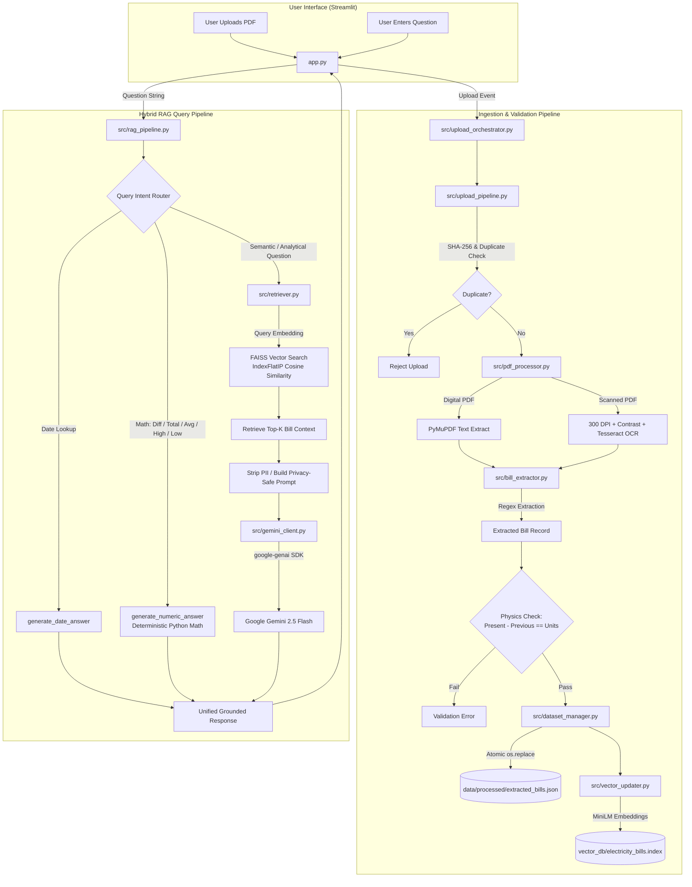

# ⚡ AI Electricity Bill Analyzer & Energy Assistant

[](https://electricity-bill-analyzer-ktmi.onrender.com)
[](https://www.python.org/)
[](https://streamlit.io/)
[](https://ai.google.dev/)
[](https://github.com/facebookresearch/faiss)
[](https://huggingface.co/sentence-transformers/all-MiniLM-L6-v2)
[]()

> 🌐 **Live Application**: [https://electricity-bill-analyzer-ktmi.onrender.com](https://electricity-bill-analyzer-ktmi.onrender.com)

An end-to-end, enterprise-grade **Retrieval-Augmented Generation (RAG)** application and analytics dashboard designed to ingest, validate, analyze, and query **Andhra Pradesh electricity bills (APEPDCL)**.

The system combines **dual-engine document ingestion (PyMuPDF + Tesseract OCR)**, **strict physical validation**, **FAISS vector search**, and a **hybrid deterministic-generative RAG pipeline** that eliminates LLM arithmetic hallucinations by performing calculations in Python while leveraging **Google Gemini** for grounded conversational explanations.

---

## 📑 Table of Contents

- [Key Highlights](#-key-highlights)
- [System Architecture & Data Flow](#-system-architecture--data-flow)
- [Project Directory Structure](#-project-directory-structure)
- [How the Components Connect & Work](#-how-the-components-connect--work)
  - [1. Ingestion & Dual OCR Pipeline](#1-ingestion--dual-ocr-pipeline)
  - [2. Physical & Data Integrity Validation](#2-physical--data-integrity-validation)
  - [3. Vector Indexing & Semantic Search](#3-vector-indexing--semantic-search)
  - [4. The Hybrid RAG Engine (Why It's Special)](#4-the-hybrid-rag-engine-why-its-special)
  - [5. Transactional Upload Orchestration & Rollback](#5-transactional-upload-orchestration--rollback)
  - [6. Streamlit Interactive Dashboard](#6-streamlit-interactive-dashboard)
- [Installation & Setup Guide](#-installation--setup-guide)
- [Running the Application](#-running-the-application)
- [Sample Queries & Test Cases](#-sample-queries--test-cases)
- [Privacy & Security Guarantee](#-privacy--security-guarantee)

---

## 🌟 Key Highlights

1. **Zero Arithmetic Hallucinations (Hybrid RAG)**:
   Standard LLMs frequently make errors when calculating differences, totals, or averages across electricity bills. This system routes mathematical queries (highest, lowest, difference, average, totals, comparisons) and date lookups directly to deterministic Python execution while reserving Google Gemini for grounded natural language reasoning.
2. **Dual-Mode Document Extraction**:
   Extracts digital text via PyMuPDF in milliseconds; automatically falls back to 300 DPI grayscale contrast-enhanced OCR with Tesseract when scanned or rasterized bills are detected.
3. **Physics-Based Validation**:
   Enforces real-world electricity billing constraints:
   $$\text{Present Reading (kWh)} - \text{Previous Reading (kWh)} = \text{Billed Units}$$
   Rejects inverted readings, negative charges, and dates where due date precedes bill date.
4. **Transactional Updates with 2-Phase Rollback**:
   When a user uploads a new bill, the system validates the file, checks SHA-256 duplicate hashes, atomically appends to JSON, and updates the FAISS vector index in-memory. If any step fails, it automatically executes a clean rollback to the exact previous state.
5. **Privacy-Preserving AI**:
   Raw OCR text and customer personally identifiable information (consumer name, address, service number) are stripped before prompting Gemini. Only sanitized numerical and category fields are provided as context.

---

## 🏗️ System Architecture & Data Flow



---

## 📂 Project Directory Structure

```text
├── .streamlit/
│   └── config.toml                  # Streamlit theme & UI styling configuration
├── data/
│   ├── historical/                  # Historical bill PDFs (April - August 2026) [.gitkeep]
│   ├── processed/
│   │   ├── historical_bills.json    # Clean benchmark numerical records
│   │   └── extracted_bills_draft.json # Active working dataset with extracted text
│   └── uploads/                     # Dynamically uploaded customer bills [.gitkeep]
├── src/
│   ├── batch_extractor.py           # Batch processes historical PDFs into structured JSON
│   ├── bill_extractor.py            # Regex-based extraction of billing fields & readings
│   ├── compare_datasets.py          # Field-by-field tolerance benchmark vs ground truth
│   ├── dataset_manager.py           # Atomic JSON writing & duplicate record prevention
│   ├── document_chunker.py          # RecursiveCharacterTextSplitter with metadata tagging
│   ├── embed_documents.py           # Sentence-Transformers vectorizer & FAISS index builder
│   ├── gemini_client.py             # Singleton Google GenAI SDK client with error handling
│   ├── pdf_processor.py             # Dual digital / 300 DPI Tesseract OCR PDF processor
│   ├── rag_pipeline.py              # Central RAG orchestrator, intent router & arithmetic engine
│   ├── retriever.py                 # Cosine similarity vector search over FAISS
│   ├── upload_orchestrator.py       # Transactional pipeline with full state rollback on failure
│   ├── upload_pipeline.py           # Validation rules, SHA-256 deduplication & meter checks
│   ├── validate_dataset.py          # Automated verification of meter reading physics
│   └── vector_updater.py            # Incremental FAISS vector insertion with backup snapshots
├── tests/                           # Unit and integration test suite [.gitkeep]
├── utils/                           # Shared utility helpers [.gitkeep]
├── vector_db/
│   ├── chunks_metadata.json         # Chunk text and source document metadata [.gitkeep]
│   └── electricity_bills.index      # FAISS IndexFlatIP normalized vector database
├── .env.example                     # Sample environment variable template
├── .gitignore                       # Strict Git exclusion rules (protects PII & PDFs)
├── app.py                           # Streamlit Web App & Interactive Analytics Dashboard
├── config.py                        # Centralized application settings, constants & paths
├── ocr_confidence_check.py          # Diagnostic script measuring OCR word confidence
├── requirements.txt                 # Pinned project dependencies
└── README.md                        # Project documentation & presentation guide
```

---

## 🔗 How the Components Connect & Work

### 1. Ingestion & Dual OCR Pipeline
- **`src/pdf_processor.py`**: When a bill is processed, it first invokes `page.get_text("text")` via **PyMuPDF**. If digital text is missing (e.g. scanned receipt), it converts the PDF page into a 300 DPI image (`pix.get_pixmap(dpi=300)`), converts it to 8-bit grayscale, applies a **1.5x contrast boost** with Pillow, and extracts words and confidence scores using **Tesseract OCR** (`--oem 3 --psm 6`).
- **`src/bill_extractor.py`**: Runs robust regex patterns over the full text to parse key fields:
  - Bill Date & Due Date (e.g., `09-Apr-2026`, `23-Apr-2026`)
  - Present Reading (kWh) & Previous Reading (kWh)
  - Billed Units (Import Units)
  - Charges: Energy Charges, Fixed Charges, Customer Charges, and Net Bill Amount.

### 2. Physical & Data Integrity Validation
- **`src/upload_pipeline.py` & `src/validate_dataset.py`**:
  - **SHA-256 Hash Check**: Computes the cryptographic checksum of incoming files to prevent identical PDFs from being processed twice.
  - **Meter Reading Physics**: Verifies that $\text{Present Reading} - \text{Previous Reading} \approx \text{Billed Units}$ (within $0.01$ tolerance). If a meter reading was misread by OCR or tampered with, ingestion fails immediately.
  - **Temporal Consistency**: Enforces that the payment `due_date` is strictly after the `bill_date`.
- **`src/dataset_manager.py`**: Appends validated records using atomic file operations (`tempfile` + `os.fsync` + `os.replace`). This guarantees the primary JSON database is never corrupted if a crash or power cut occurs during disk write.

### 3. Vector Indexing & Semantic Search
- **`src/document_chunker.py`**: Uses LangChain's `RecursiveCharacterTextSplitter` configured for `chunk_size=500` characters with `chunk_overlap=50` characters. Each chunk is tagged with its source month, PDF filename, and chunk sequence index.
- **`src/embed_documents.py` & `src/vector_updater.py`**: Generates 384-dimensional dense vector embeddings using `sentence-transformers/all-MiniLM-L6-v2`. Embeddings are L2-normalized, allowing **`faiss.IndexFlatIP`** (Inner Product) to compute exact **Cosine Similarity**.
- **`src/retriever.py`**: Searches the top-$k$ nearest neighbors for any user query, returning relevant text snippets, similarity scores, and document origin metadata.

### 4. The Hybrid RAG Engine (Why It's Special)
Traditional RAG pipelines blindly feed retrieved context into an LLM and ask it to perform calculations, resulting in frequent arithmetic mistakes.
**`src/rag_pipeline.py`** uses an **Intent-Driven Architecture**:
1. **Month & Range Detection**: Identifies whether the user is asking about a specific month (e.g., "May") or a range (e.g., "between April and August").
2. **Intent Classification**: Detects mathematical operations (`highest`, `lowest`, `difference`, `total`, `average`, `comparison`, `lookup`).
3. **Deterministic Python Execution**:
   - For differences: $`|\text{Value}_1 - \text{Value}_2|`$ is computed in Python and formatted into currency/unit strings.
   - For totals/averages: Python aggregates values across validated structured records.
   - For dates: Read directly from validated structured fields.
4. **Context Scrubbing & Gemini LLM Call**:
   When the question asks for explanations, reasons, or unstructured analysis, the system constructs a privacy-safe prompt containing ONLY verified billing metrics, omitting raw OCR text, account numbers, and addresses. It then invokes Google Gemini 2.5 Flash via **`src/gemini_client.py`**.

### 5. Transactional Upload Orchestration & Rollback
- **`src/upload_orchestrator.py`**: Implements a complete two-phase commit:
  1. Captures in-memory snapshots of the structured dataset, the FAISS index binary, and chunk metadata.
  2. Extracts and validates the uploaded PDF.
  3. Appends the new record to JSON.
  4. Incrementally clones the FAISS index, generates new embeddings, and writes temporary index files.
  5. If any stage throws an exception, it triggers automatic rollback: restores original JSON and FAISS bytes, unlinks the uploaded file, and refreshes the cache.

### 6. Streamlit Interactive Dashboard
- **`app.py`**:
  - **KPI Metrics Bar**: Displays available bills count, total historical consumption, average monthly consumption, and latest net payable amount.
  - **Altair Data Visualization**: Custom bar charts of monthly consumption (kWh) with tooltips showing exact bill amounts.
  - **Detailed Bill Ledger**: Expandable table listing date, units, readings, net charges, and source PDF reference.
  - **Chat Interface**: Streamlit session-state powered conversational assistant with full history, source attribution badges, and method indicators.

---

## 🚀 Installation & Setup Guide

### 1. Prerequisites
- **Python**: Version 3.10, 3.11, 3.12, or 3.13.
- **Tesseract OCR**:
  - **Windows**: Download and install the [Tesseract installer for Windows](https://github.com/UB-Mannheim/tesseract/wiki). Ensure `C:\Program Files\Tesseract-OCR` is added to your System `PATH`.
  - **Linux (Ubuntu/Debian)**: `sudo apt-get install tesseract-ocr libtesseract-dev`
  - **macOS**: `brew install tesseract`

### 2. Clone the Repository
```bash
git clone https://github.com/<your-username>/<your-repo-name>.git
cd <your-repo-name>
```

### 3. Create & Activate a Virtual Environment
- **On Windows (PowerShell)**:
  ```powershell
  python -m venv .venv
  .venv\Scripts\Activate.ps1
  ```
- **On Linux / macOS**:
  ```bash
  python3 -m venv .venv
  source .venv/bin/activate
  ```

### 4. Install Dependencies
```bash
pip install --upgrade pip
pip install -r requirements.txt
```

### 5. Configure Environment Variables
Copy `.env.example` to create your local `.env` file:
```bash
cp .env.example .env
```
Open `.env` and insert your Google Gemini API key:
```env
GEMINI_API_KEY=AIzaSy...your_actual_key_here
APP_NAME="AI Electricity Bill Analyzer & Energy Assistant"
DEBUG=False
GEMINI_MODEL=gemini-2.5-flash
EMBEDDING_MODEL=sentence-transformers/all-MiniLM-L6-v2
```
> *(Get your free API key at [Google AI Studio](https://aistudio.google.com/))*

---

## 💻 Running the Application

### Launch the Streamlit Web Dashboard
```bash
streamlit run app.py
```
Open your browser at `http://localhost:8501`.

### Command-Line Tools & Diagnostic Scripts
You can also run any of the pipeline modules independently:

- **Interactive CLI Query**:
  ```bash
  python -m src.rag_pipeline
  ```
- **Run Meter Reading Validation**:
  ```bash
  python -m src.validate_dataset
  ```
- **Run Benchmark Dataset Comparison**:
  ```bash
  python -m src.compare_datasets
  ```
- **Check OCR Confidence Across PDFs**:
  ```bash
  python ocr_confidence_check.py
  ```

---

## 🎯 Sample Queries & Test Cases

Try asking these questions to explore the system's hybrid retrieval and calculation capabilities:

| Query Type | Sample Question | Expected Behavior |
| :--- | :--- | :--- |
| **Direct Lookup** | *"What was the electricity consumption in May?"* | Retrieves exact billed units (120 units) with source attribution. |
| **Extremum Detection** | *"Which month had the highest electricity consumption?"* | Deterministic comparison identifying August (145 units). |
| **Arithmetic Difference** | *"What is the difference in bill amount between April and August?"* | Python computes $|676.41 - 436.94| = \text{₹}239.47$ with breakdown. |
| **Aggregations** | *"What is the average consumption across all months?"* | Calculates exact mathematical mean without LLM hallucination. |
| **Date Queries** | *"When is the payment due date for the July bill?"* | Direct extraction of `24-Jul-2026`. |
| **Comparative Trend** | *"Compare electricity usage between June and August."* | Generates a structured markdown comparison table. |
| **Dynamic Ingestion** | Upload a new bill (e.g. `OCT.pdf`) via sidebar | Processes, validates meter readings, updates FAISS, and answers questions on the new month! |

---

## 🔒 Privacy & Security Guarantee

- **No PII Leaks**: Customer names, addresses, meter numbers, and service connection IDs are never sent to external LLMs.
- **Excluded by `.gitignore`**: Raw electricity bill PDFs (`*.pdf`), processed OCR transcript files with raw text, and binary vector database indices are excluded from GitHub commits to protect personal utility data.
- **Credential Safety**: API keys are loaded strictly from `.env` using `python-dotenv` and are never hard-coded in source files.

---

## 👨‍💻 Authors & Acknowledgments

- **Developer**: AI & Data Science Team
- **Target Utility**: Andhra Pradesh Eastern Power Distribution Company Limited (APEPDCL)
- **Frameworks**: Streamlit, LangChain, FAISS, PyMuPDF, Tesseract OCR, Google Gemini
